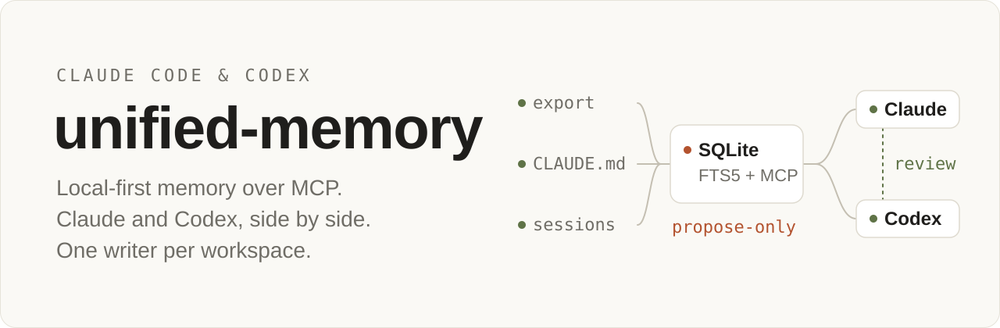
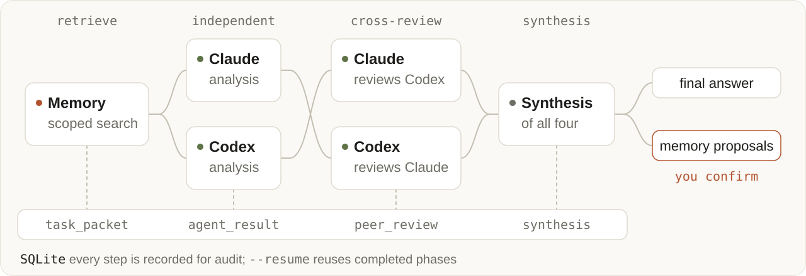

<div align="center">

<picture>
  <source media="(prefers-color-scheme: dark)" srcset="assets/hero-dark.svg">
  
</picture>

<br>


</div>

**Unified Memory Harness for Claude Code & Codex** is a **local-first, auditable** system with two independent components:

1. **Unified memory layer.** Indexes your Claude web/account export *and* your local Claude Code assets (`CLAUDE.md`, auto-memory, session transcripts) into one searchable, provenance-tracked SQLite store, plus a typed/versioned derived-memory layer. Exposed to agents via a **Memory MCP server**.
2. **Collaboration scheduler.** Drives **Claude and Codex** to answer the same question: independent analysis → cross-review → synthesis, with structural guarantees (single-writer workspace lease) and full auditability.

> **Status:** runnable vertical slice, 60 tests. The deterministic spine (schema, streaming importer, search, Memory MCP, council orchestrator, demo) is complete and tested. The Memory MCP server is verified booting as a **real stdio subprocess**, and both the Claude and Codex adapters plus a **full real dual-agent council** have been run end-to-end against the live CLIs (see [Real agents](#real-agents-authentication)). Adapters still default to **mock** so the demo/tests stay offline and free. `builder-reviewer` / `tournament` modes ship as documented interfaces on top of the working single-writer lease (see [Task modes](#task-modes)).

## Why two components

This is not "sync Claude memory to GPT". The memory layer decides **what knowledge each agent can retrieve and write**. The scheduler decides **when each agent runs, what it sees, who executes, and when to stop**. MCP is a great fit for the memory tools but should not carry the whole orchestration, so they're separate. See [`docs/ARCHITECTURE.md`](docs/ARCHITECTURE.md).

## Install

```bash
npm install                       # better-sqlite3, stream-json, @modelcontextprotocol/sdk, zod
cp config.example.json config.json   # edit paths (config.json is gitignored)
npm test                          # 60 tests, offline
node --experimental-strip-types src/cli/index.ts demo   # offline end-to-end demo
```

Requires Node ≥ 22.6 (uses native TypeScript type-stripping, no build step). A convenience alias:

```bash
alias umem='node --experimental-strip-types --no-warnings src/cli/index.ts'
```

## ccc: own two-column UI, Claude Code as the engine

`ccc` keeps its **own UI**: a bordered prompt-box REPL and two live-streaming answer panels with `model · effort` titles, a live tail view and a full final render. The **engine underneath is the Claude Code harness**:

- **Same workspace.** Both sides run in **your real working directory**.
- **Sessions persist across REPL turns** on BOTH sides, so follow-up questions keep full context. Verified end-to-end: a code word set in turn 1 is recalled by both models in turn 2.

```bash
npm link                 # installs `ccc` (and `umem`) into your global bin
ccc                      # prompt-box REPL: two streaming columns, session continuity
ccc "这个 repo 的构建流程是怎样的?"   # one-shot, workspace-aware
ccc --council "..."      # additionally run cross-review + synthesis
ccc --mock "..."         # offline/free layout test
ccc --tui                # optional: hand the terminal to the real Claude Code TUI
ccc -p "什么是 DNS?"      # one-shot markdown print via the TUI kernel (no UI)
```

| | Claude | Codex |
|:--|:--|:--|
| Streaming | per token, via `stream-json` deltas | per message chunk |
| Context | its normal harness context (CLAUDE.md, read tools) | reads the same workspace in a read-only sandbox |
| Session resume | `claude -p --resume <session_id>` | `codex exec resume <thread_id>` |
| Defaults | `claude-fable-5`, permission-mode `default`, no plan narration | its config.toml default model, with **fast mode** on (`service_tier=fast`, 1.5x speed / 2.5x credits; `--no-fast` to disable) |

- **Codex cost** shows as `≈$`: an API list-price conversion, since ChatGPT plans bill in credits.
- **Note:** `codex exec resume` does not accept `-s`/`-m`/`-C`. Sandbox, model, and cwd stay pinned by the original session.
- **Audit:** every Q&A is recorded to the audit trail (`tasks` mode `qa` + `agent_runs`).

## Quick start

```bash
umem import claude-export --dir /path/to/claude-export      # 1,656 conv / 19,249 msgs in ~10s
umem import claude-code --sessions --max-sessions 25        # CLAUDE.md + auto-memory + sessions
umem inventory                                              # counts only, no content

umem search "索引 优化"                     # bilingual: 2-char CJK works (LIKE recall net)
umem search "flywheel tuning" --provider claude-code --role assistant
umem search "deep research" --kind memory --limit 5

umem council "How should I structure the importer for resumability?"   # dual-agent (mock by default)
umem memory recent --type instruction
```

## Search

FTS5 **trigram** index (ranked; handles English + CJK substrings ≥3 chars) **plus a `LIKE` recall net** for short/2-char CJK terms that trigram can't match (`索引`, `检索`, …). Natural-language questions are tokenized into keywords, not phrase-matched. Scope with `--provider`, `--project`, `--role`, `--source-type`, `--kind`, `--limit`. See [ADR-0001](docs/ADR-0001-storage-sqlite-fts5.md).

## Memory model

Typed, scoped, versioned derived knowledge.

- **Types:** `instruction`, `semantic`, `decision`, `episodic`, `procedural`, `working`.
- **Every item carries** `scope` (global/project/task), `confidence`, `sensitivity`, `status` (proposed→active→superseded→forgotten), `source_refs`, and an **append-only version history** with a tamper-evident hash chain.
- **Agents may only propose.** Activation/override needs the user (or an explicit policy flag).
- **Credentials are always rejected**; PII is flagged and gated.

```bash
umem memory propose --type decision --title "Use trigram+LIKE" --body "…" --scope project --project myrepo
umem memory confirm 42        # proposed → active (user only)
umem memory versions 42       # full history
umem memory forget 42 --why "obsolete"   # soft delete; history retained
```

## Memory MCP server

Seven tools: `memory_search`, `memory_get`, `memory_propose`, `memory_update`, `memory_forget`, `memory_recent`, `memory_sources`. Propose-only for agents; global/active items are protected from agent mutation unless `UMEM_MCP_ALLOW_OVERRIDE=1`.

```bash
umem mcp-config      # prints an --mcp-config snippet
# Attach to a headless Claude run:
claude -p --mcp-config <(umem mcp-config) --allowed-tools 'mcp__unified-memory__*' "recall what I decided about the importer"
```

## Collaboration

<picture>
  <source media="(prefers-color-scheme: dark)" srcset="assets/council-dark.svg">
  
</picture>

<details>
<summary>Text version of the diagram</summary>

```
retrieve scoped memory → Claude ‖ Codex independent analysis → cross-review → synthesis
```

</details>

`umem council "<question>"` runs the full flow. Every agent run, tool call, message, artifact, and memory change is recorded in SQLite for audit. Runs are **resumable** (`--resume <taskId>` reuses completed phases). Default adapters are **mock** (deterministic, offline, free); the two mock agents diverge on purpose so cross-review surfaces real disagreements.

### Task modes

| Mode | What it does | Status |
|:--|:--|:--|
| `council` | discuss only, no writes | **implemented** (mock + real adapters) |
| `builder-reviewer` | one agent writes (holds the lease), the other reviews + runs tests; ≤3 fix rounds | interface + working single-writer lease; execution loop is the next slice |
| `tournament` | both implement in **separate git worktrees**, pick by tests/review | interface + lease; worktree provisioning is the next slice |

The **single-writer guarantee** is structural: a partial-unique index makes it *impossible* for two runs to hold a write lease on one workspace (`src/orchestrator/lease.ts`). The `demo` proves a second acquire is blocked. See [ADR-0002](docs/ADR-0002-collaboration-protocol.md).

## Real agents (authentication)

By default everything runs on **mock** adapters: no network, no auth, no cost. To use the real CLIs, set the adapter in `config.json`:

```json
"agents": {
  "claude": { "adapter": "claude-cli", "model": "claude-opus-4-8", "enabled": true },
  "codex":  { "adapter": "codex-cli",  "model": "gpt-5-codex",     "enabled": true }
}
```

Then check availability and run:

```bash
umem agents status         # verifies `claude` / `codex` binaries respond
umem council "…"           # now invokes the real CLIs
```

- **Claude adapter:** `claude -p --output-format json --json-schema '<inline JSON>' [--mcp-config] [--model] [--append-system-prompt]` (prompt on stdin; note `--json-schema` takes the schema **inline**, not a file). Verified returning a valid structured `AgentResult` with cost.
- **Codex adapter:** `codex exec --json --output-schema <file> --output-last-message <file> -s read-only [-C <dir>] [-m <model>]` (prompt on stdin; `--output-schema` takes a **file**). Verified returning a valid structured `AgentResult`.

A full real council (Claude ‖ Codex → cross-review → synthesis) has been run end-to-end. Real reviews carry large context; a phase that exceeds the timeout is recorded as `failed` and the council **degrades gracefully** and still synthesizes (proven on a real timeout; default phase timeout is now 300s).

> **Cost and credentials.** Both require an authenticated CLI and **may incur cost** (~$1 + tokens for one full council). This tool does not manage their credentials: authenticate them yourself before switching off mock.

## Privacy & safety

- **Raw archive = evidence layer:** message content stored **as-is** (never scrubbed; that would destroy evidence). Access-gated by living in gitignored `data/`.
- **Derived layer + logs + fixtures:** secrets blocked, PII masked. The DB itself is a sensitive artifact and is **gitignored**.
- **`users.json`** (pure PII) is recorded as provenance (path + hash), content **not ingested**.
- **Credentials never reach `memory_items` on any path:** agent/user `propose`/`update` hard-reject secrets; bulk import (CLAUDE.md, auto-memory, docs) masks them (`stripSecrets`). `memory_get`/search hide both `sensitive` and `secret` bodies.
- Delete/undo/version-history/audit supported. No cloud upload, third-party embedding, or external calls happen without explicit opt-in. See [ADR-0003](docs/ADR-0003-privacy-model.md).

## Layout

```
src/db/         schema.sql + better-sqlite3 wrapper + audit
src/ingest/     streaming import (export + Claude Code), redaction, sources/checkpoints
src/search/     trigram FTS + LIKE recall net + scope filters
src/memory/     typed/versioned memory CRUD (propose/confirm/update/forget/restore)
src/mcp/        Memory MCP server (7 tools)
src/agents/     protocol types + Claude/Codex/mock adapters
src/orchestrator/  council flow + structural write-lease
src/cli/        umem CLI + offline demo
test/           60 node:test tests (synthetic fixtures only)
docs/           ADRs + architecture + inventory report
fixtures/       synthetic (fake) test data
```

## Tests

`npm test` runs 60 tests. All use **synthetic data**; no real content in fixtures.

| Area | Covered |
|:--|:--|
| Redaction | credentials detected as secret, PII flagged as sensitive, masking |
| Import | idempotency, evidence-layer integrity, PII non-ingest |
| Search | CJK, tokenization, scope, FTS-injection safety |
| Memory | versioning, secret/PII gates, forget |
| Lease | single-writer + crash reclaim |
| Council | flow, resume, adapter-failure tolerance |
| MCP server | propose-only, protection, provenance |
| `ccc` TUI | CJK/emoji display width, input box and panel layout, streaming output |

The code was hardened by an **adversarial multi-agent review** (5 dimensions × independent verify): 10 confirmed findings fixed, each with a regression test in `test/fixes.test.ts`:

- two credential-leak paths (ingest bypassing the secret gate; the `secret` tier falling through the get/search body-hide)
- a session cross-deletion bug (identity from filename now)
- stale/duplicate account memory
- permanent lease bricking on crash (pid reclaim now)
- a task+project scope exclusion
- assistant-text-block loss (concatenate now)

See [`docs/ADR-*`](docs/).
